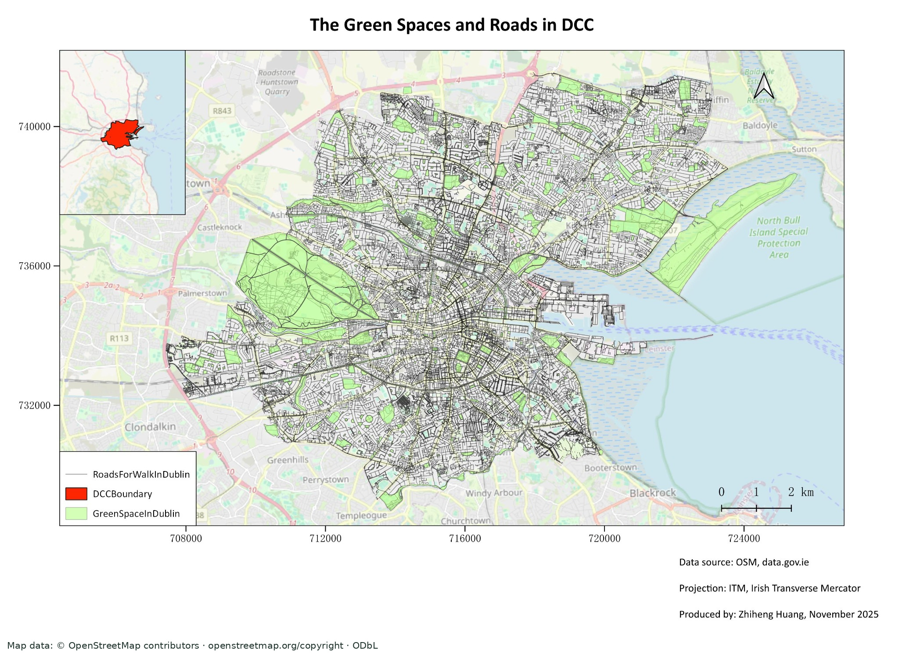
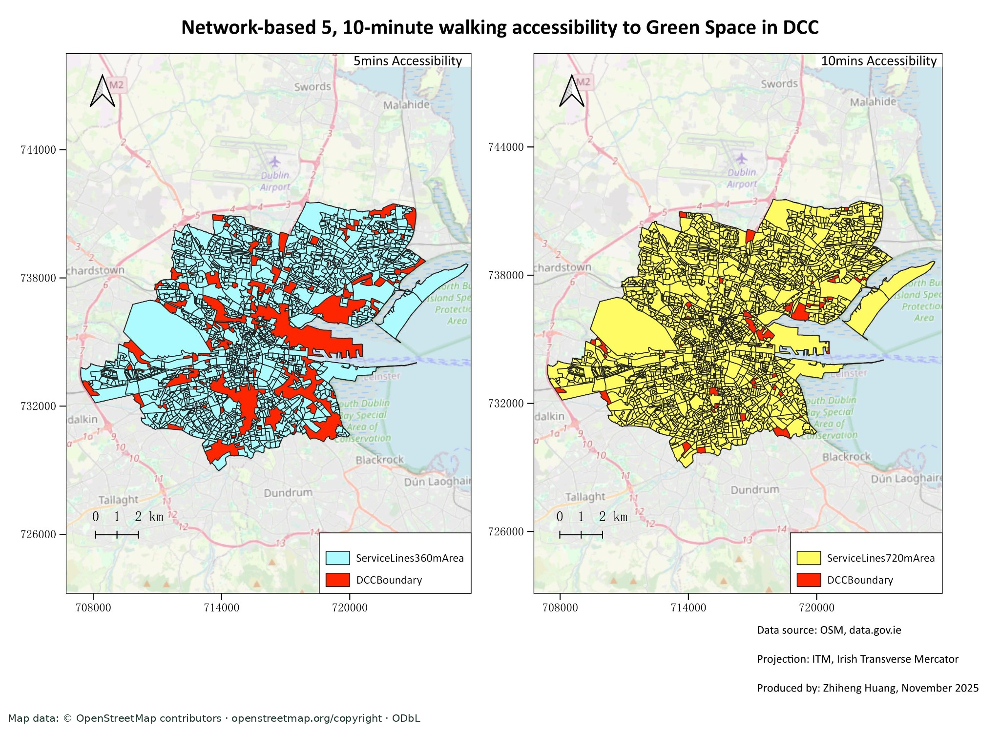
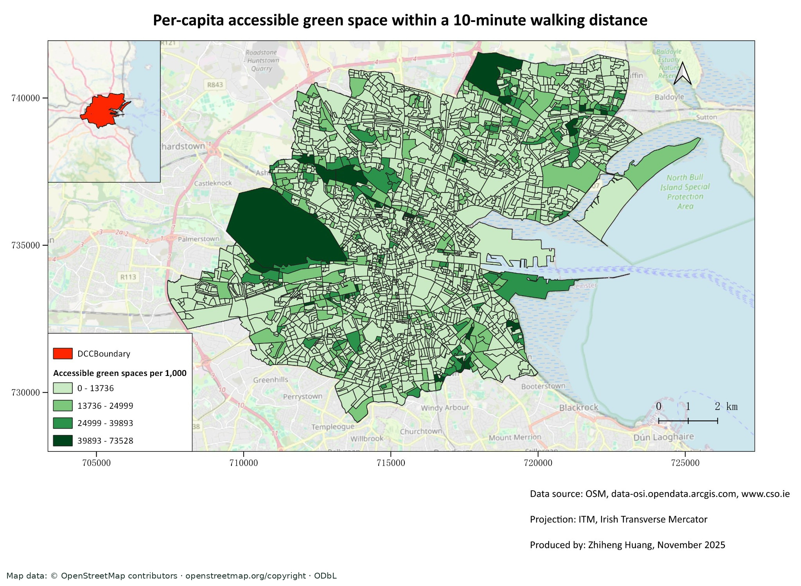

# Network-Based Green Space Accessibility in Dublin

**Zhiheng Huang · Visual GIS case study · MSc coursework, Trinity College Dublin**

**How accessible are public green spaces across Dublin City Council, and does proximity translate into equitable green space per resident?**

This case study combines a selected street network, public green-space polygons and Census 2022 Small Area populations to examine the difference between being near a park and the amount of green space associated with each resident. The coursework's central finding is descriptive: **high reported proximity coverage can coexist with substantial spatial inequality in green space per resident**.

**Public portfolio release.** The author confirms permission for public display of the existing coursework maps. The maps and numerical findings are original coursework outputs checked against the submitted report; the GIS analysis was **not independently reproduced** during this portfolio preparation. The study describes its 2025 workflow and source data, rather than current conditions in Dublin.

## Study setting and reported evidence

The study covers the Dublin City Council (DCC) area. Its full study subset is reported as **2,354 Small Areas with a combined `Pop_total` of 571,782**. These are the assignment's subset totals, not an independently validated municipal census total.

| Reported spatial-overlay subset | Small Areas intersecting the service-area approximation | Sum of those Small Areas' full recorded population |
| --- | ---: | ---: |
| 360 m network threshold, nominally 5 minutes | 1,610 | 409,115 |
| 720 m network threshold, nominally 10 minutes | 2,180 | 532,949 |
| Full DCC study subset | 2,354 | 571,782 |

Source: submitted coursework, p.16, Table 3; study-subset preparation on p.12. **The population sums describe the intersecting Small Areas, not individually verified residents with 5- or 10-minute access.** The report also describes area-weighted allocation on p.13, but Table 3 reports full `Pop_total` sums. The two quantities are not interchangeable; no resolved area-weighted population estimate is asserted here.

## Map gallery

All three maps below are **original coursework maps, not regenerated in this phase**. Their map classes, legends, labels and source credits are preserved. Full-resolution files are available through the links below each caption.

Cartography: Zhiheng Huang, November 2025. Street data and basemap: **[© OpenStreetMap contributors](https://www.openstreetmap.org/copyright)**; OSM data are available under the ODbL. Five assets with visible OSM basemap imagery also carry an attribution strip appended below the original map/screenshot area. Other reported sources: Dublin City Council, Central Statistics Office and Ordnance Survey Ireland / Tailte Éireann. These credits do not establish exact source-file matches or reuse permission. See [data attribution](methodology/data_sources.md) and [asset provenance](figures/PROVENANCE.md).

### Green spaces and the selected street network

Large parks, including Phoenix Park, sit alongside smaller spaces dispersed through the city. The dark lines show the selected OSM network used by the coursework; they are not an independently audited inventory of legally accessible pedestrian routes. Original internal legend names refer to the street network, DCC study boundary and selected green spaces. Data credits: Dublin City Council, [Administrative Areas DCC 2019](https://data.gov.ie/dataset/administrative-areas-dcc) and [Parks and Open Spaces DCC 2016](https://data.gov.ie/dataset/parks-and-open-spaces-dcc), ([CC BY 4.0](https://creativecommons.org/licenses/by/4.0/); the coursework filters/clips and combines the source polygons with other layers); [© OpenStreetMap contributors](https://www.openstreetmap.org/copyright), ODbL.

[Open full-size map](figures/green_spaces_and_roads.jpg)

### Network-based 5- and 10-minute accessibility approximation

The left and right panels show the reported 360 m and 720 m thresholds. At a nominal **1.2 m/s**, these correspond to approximately five and ten minutes. The workflow buffered reachable service lines into polygons for overlay; these are **network-derived coverage approximations, not validated walking isochrones** or door-to-park travel times. `ServiceLines360mArea` and `ServiceLines720mArea` are the original coverage-layer labels. Data credits: Dublin City Council, [Administrative Areas DCC 2019](https://data.gov.ie/dataset/administrative-areas-dcc) and [Parks and Open Spaces DCC 2016](https://data.gov.ie/dataset/parks-and-open-spaces-dcc), ([CC BY 4.0](https://creativecommons.org/licenses/by/4.0/); the coursework filters/clips and combines the source polygons with other layers); [© OpenStreetMap contributors](https://www.openstreetmap.org/copyright), ODbL.

[Open full-size map](figures/walking_accessibility_5_10_min.jpg)

### Accessible green space per 1,000 residents

The indicator is reported in **m² per 1,000 residents** at the nominal ten-minute threshold. The coursework identifies high values around Phoenix Park and several peripheral areas, alongside low values in many inner-city and southern Small Areas (pp.17–19). It is an overlay-based supply proxy, not measured park use, visitor capacity or a causal environmental-justice result. The lowest legend class combines zero and positive values; it does not identify which areas have exactly zero. Map sources: Tailte Éireann / CSO Small Area boundaries, Census 2022 SAPS (CSO), DCC Parks and Open Spaces, and © OpenStreetMap contributors (ODbL); see [source details and links](methodology/data_sources.md).

[Open full-size map](figures/per_capita_accessible_green_space.jpg)

## Data and method

The report states **QGIS 3.28.11**, **Irish Transverse Mercator, EPSG:2157**, QuickOSM and GRASS `v.clean`. It combines DCC boundary and park data, OSM streets, Census 2022 Small Area boundaries and SAPS population tables. The cited parks catalog represents a 2016 mapping exercise; acquisition dates and exact versions of the working files are not established.

The reported workflow:

1. Harmonise the working CRS, repair geometry and restrict layers to the study area.
2. Filter public green-space typologies and selected OSM highway classes; clean the network.
3. Represent park access points through boundary/network intersections and thinning, as described in the report.
4. Generate service lines at 360 m and 720 m; convert them into narrow buffers and remove overlaps.
5. Overlay the resulting approximation with Small Areas for population summaries.
6. Attribute intersected park-fragment area to Small Areas and divide by population, scaling to 1,000 residents.

Read the [methodology with three actual workflow screenshots](methodology/workflow.md) for the original filter, population distinction and indicator definition. No processing scripts, synthetic results or replacement maps have been created.

## Interpretation and limits

The planning implication is to examine both proximity and relative green-space supply. A nearby small park may be associated with a large resident population, while a large park can produce a high indicator in adjacent Small Areas. This supports closer investigation of local provision; it does not establish actual crowding, unused capacity or intervention effects.

Fixed walking speed does not capture differences in mobility. Entrance representation, network connectivity and pedestrian permissions, buffer width, Small Area population distribution and boundary effects remain uncertain. Park quality, facilities, opening hours and private or semi-public green space are outside the indicator. Exact data versions, overlay calculations and the source report's area-weighting ambiguity have not been resolved by a rerun.

See [limitations and verification status](methodology/limitations_and_verification.md) for the distinction between source checking and computational reproduction.

## Sources, provenance and reuse

The author confirms permission for public portfolio display of the selected original maps and screenshots. This is not a claim that the GIS workflow or source snapshots were independently reproduced or revalidated for this release. No geodata, source layers or QGIS project are included. This repository has no explicit open-source licence and does not grant a blanket licence to third-party materials.

This work originated in **MSc Advanced Spatial Analysis using GIS, Trinity College Dublin**, submitted in December 2025. It is coursework, not peer-reviewed research. The original report is the authority for reported methods and findings and is retained privately.

[DCC / Smart Dublin](https://data.smartdublin.ie/dataset/administrative-areas-dcc), [DCC parks catalog](https://data.gov.ie/dataset/parks-and-open-spaces-dcc), [CSO SAPS 2022](https://www.cso.ie/en/census/census2022/census2022smallareapopulationstatistics/) and [Tailte Éireann Small Area boundaries](https://data-osi.opendata.arcgis.com/datasets/9472cff586d74f2ba3c240d4344c5720_0/explore) are linked for attribution. These links do not redistribute spatial files or verify the exact original snapshots. The DCC parks catalog labels its 2016 resource CC BY 4.0; the linked 2019 DCC administrative-area resource is separately catalogued under CC BY 4.0; CSO provides general reuse terms for published statistics; Tailte Éireann states open-data reuse is subject to attribution and applicable terms. These links document the reported source families; exact original snapshots were not independently revalidated. The author confirms permission for public display of the existing map assets. No source datasets or GIS project files are redistributed, and no blanket licence is granted to third-party materials.

The repository contains selected images and documentation only. The private report, QA-only population map, original QGIS project and all geodata are excluded. The analysis is presented with its source-reported status and methodological limitations.

## Licence status

This repository has no explicit open-source licence. Third-party materials remain subject to their own terms and attribution; this repository does not grant a blanket licence.
