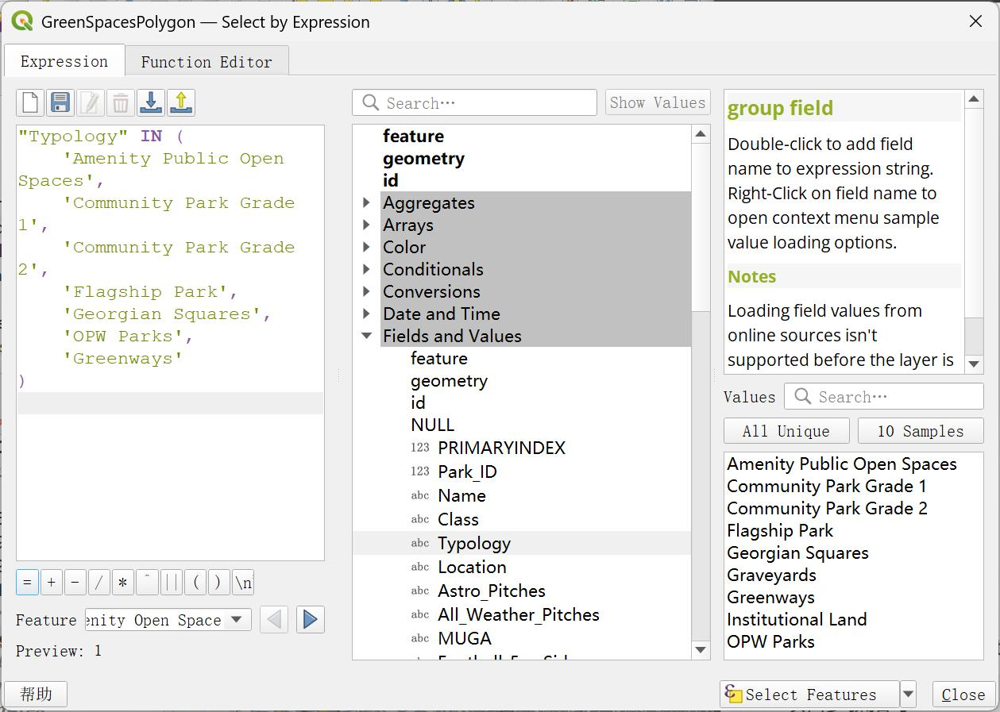
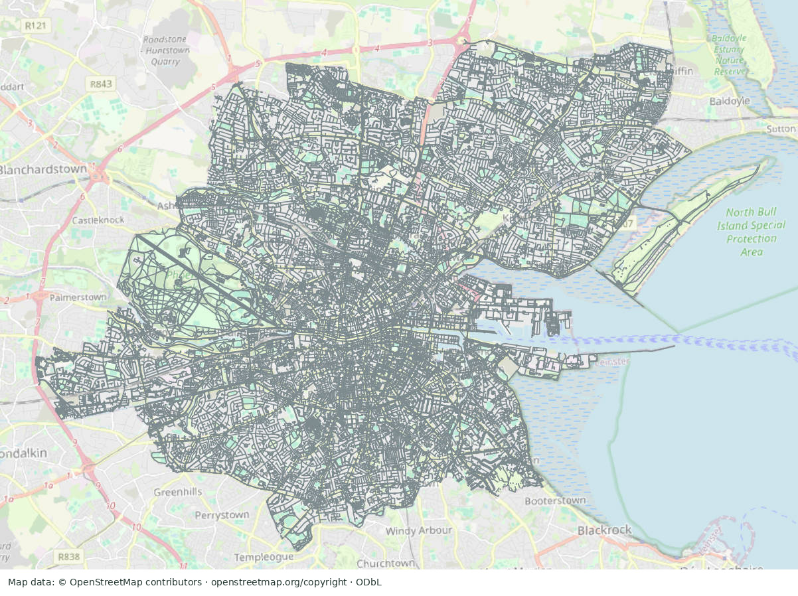
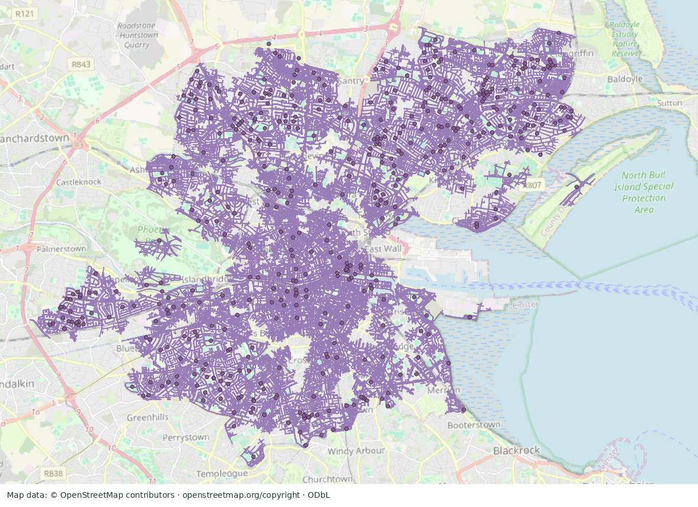

# Reported GIS workflow

This page documents the **original coursework workflow** from the submitted report, pp.8–14. It is not a processing log from this phase or an independently executable reconstruction. The three screenshots are actual supplied coursework evidence, copied unchanged. Their presence does not validate network topology, parameters or output attributes.

**Reported environment:** QGIS 3.28.11; Irish Transverse Mercator (ITM), **EPSG:2157**; QuickOSM; GRASS `v.clean`; core geometry, network, overlay, field-calculation and layout tools.

The road/network previews use an OSM basemap: [© OpenStreetMap contributors](https://www.openstreetmap.org/copyright), with OSM data under the ODbL. See [data sources](data_sources.md) for additional attribution.

## 1. Assemble the study layers and working CRS

The report combines a DCC study boundary, selected green-space polygons, OSM roads, Census 2022 Small Area polygons and SAPS population attributes. It reports EPSG:2157 for metre-based distance/area operations and clipping to the study extent (pp.8–12).

Small Area attributes were joined using common GEOID identifiers. The report names `SA_GEOGID` in its dataset description and says `Pop_total` was constructed by summing age-specific population counts. The full study subset is reported as 2,354 Small Areas, total 571,782 and mean approximately 243 residents per area. The precise census columns, join completeness and boundary resource were not independently checked.

QGIS `Check validity` / `Fix geometries` and GRASS `v.clean` are described among the preparation tools. The source also lists `Set layer CRS`; source CRS metadata and actual transformation history are unavailable, so CRS harmonisation remains a reported method rather than a verified transformation.

## 2. Filter green-space typologies

The supplied expression screenshot shows selection on `Typology`. The included category names are:

| Retained typology |
| --- |
| Amenity Public Open Spaces |
| Community Park Grade 1 |
| Community Park Grade 2 |
| Flagship Park |
| Georgian Squares |
| OPW Parks |
| Greenways |

Institutional land and graveyards are excluded. This preserves the source's operational definition of public green space; it does not verify access arrangements or opening hours for every polygon.

**Original workflow screenshot, not a new execution.** The expression and category list provide direct evidence of the selection rule (report p.12, Figure 3). No private file path or student identifier is visible.

## 3. Select and clean the street network

QuickOSM supplied OSM line features using key `highway`. Table 1 on p.8 lists:

`residential`, `tertiary`, `secondary`, `primary`, `living_street`, `service`, `unclassified`, `pedestrian` and `footway`.

The abstract/results describe this more briefly as local/residential streets. This page preserves the complete Table 1 list, including primary and secondary roads. Highway classification alone does not establish pedestrian permission, safe crossings or barrier-free travel; the source does not furnish a complete access-tag filtering or routing configuration.

The road layer was clipped and cleaned using the reported QGIS/GRASS tools. Cleaning tolerances, snapping rules, edge directions and connectivity tests are not available in the starter.

**Original workflow screenshot, not a topology test.** The source filename was `v.grass.jpg` and the report Figure 2 caption uses that wording; the tool table identifies **GRASS `v.clean`** (pp.10–11). The raster is evidence of a network preview, not proof that every topology error was repaired.

## 4. Represent access points and generate service lines

The report describes dissolving parks, intersecting green-space boundaries with the road network, converting network-contact vertices to entrance points and applying modest thinning to avoid redundant frontage points (p.12). It also contains a centroid preview elsewhere; that image does not establish that centroids were validated park entrances. Exact access-point provenance and thinning parameters remain unverified.

The service-line flowchart on p.13 names the core Network Analysis **“Service Area from layer”** function. Reachable street edges were extracted at **360 m** and **720 m** from the reported access points. With the source's nominal **1.2 m/s** walking speed:

| Nominal duration | Distance calculation | Network threshold |
| --- | --- | ---: |
| 5 minutes | 1.2 m/s × 300 s | 360 m |
| 10 minutes | 1.2 m/s × 600 s | 720 m |

These conversions are arithmetic assumptions, not observed travel times.

**Original workflow screenshot, not a rerun.** This distinct network-line view supports the documented service-line approach. The markers' precise input construction and snapping are not validated from the raster.

The report says the lines were converted into thin buffers, overlapping buffers eliminated, and service-area polygons used for overlay. Buffer width is not stated. These polygons approximate network-associated coverage; they are not full walking isochrones, parcel/residence-level catchments or validated paths to every park entrance.

QNEAT3 and ORS Tools were explored but not used in the final approach; the report describes processing failures/crashes. DataPlotly was also explored unsuccessfully. They are not presented as working tools or reproduced outputs in this case study.

## 5. Keep the two population quantities distinct

The source describes two different operations:

| Quantity | Source definition / evidence | What can be reported |
| --- | --- | --- |
| Population total for selected Small Areas | Table 3, p.16: sum of `Pop_total` across areas intersecting the threshold approximation | 409,115 for 1,610 areas at 360 m; 532,949 for 2,180 areas at 720 m |
| Area-weighted served-population estimate | Prose on p.13: multiply each area's `Pop_total` by its overlap-area proportion | Method described; no disambiguated, independently verified total available here |

The described weighting rule is:

`estimated served population = sum over Small Areas of [Pop_total × (service overlap area / Small Area area)]`.

This expression documents the source description only. It was not executed in this phase. Table 3's full-area population sums are **not** treated as outputs of that weighted expression. A Small Area intersecting a narrow service buffer may include many residents outside it; neither approach directly observes individual travel times.

The report's full subset totals are 2,354 Small Areas and 571,782 population, with reported means/medians documented in the accompanying audit. No revised coverage percentage or new population estimate has been created.

## 6. Construct the per-capita proxy and map it

The flowchart and field-calculator screenshot on p.14 describe:

1. Intersect park polygons with the 720 m service-area approximation.
2. Intersect the resulting fragments with Small Area polygons.
3. Sum fragment areas attributed to each overlapping Small Area into `ParkM2`.
4. Calculate `ParkM2pc = (ParkM2 / Pop_total) × 1,000`.

The displayed expression returns NULL for missing or nonpositive `Pop_total`; the prose says zero-population areas were excluded from the per-capita analysis. The field is reported in **m² per 1,000 residents** (p.17). Actual geometry areas, summation/deduplication, NULL handling and cartographic assignment were not recalculated.

This is the report's operational proxy for accessible green space. It attributes intersected park-fragment area to Small Areas; it does not establish that entire parks are reachable from every home or allocate park capacity across actual visitors.

The report names quantile and natural-breaks classification for choropleths. The supplied final map's classes remain unchanged; the exact classification assignment and underlying values are not inferred from the raster. The lowest class spans zero and positive values, so an exact zero-area count cannot be read from it.

Return to the [three final maps](../README.md#map-gallery), or read [limitations and verification](limitations_and_verification.md). The excluded QA population map does not supply a validated population estimate.

## Screenshot source credit

The typology-selection screen depicts Dublin City Council’s Parks and Open Spaces DCC 2016 dataset. Credit Dublin City Council, link the [dataset](https://data.gov.ie/dataset/parks-and-open-spaces-dcc) and [CC BY 4.0](https://creativecommons.org/licenses/by/4.0/), and note the coursework’s filtering/selection. The network and 720 m screenshots use the [DCC Administrative Areas 2019](https://data.gov.ie/dataset/administrative-areas-dcc) source (CC BY 4.0; the course workflow derives/clips the boundary; [licence](https://creativecommons.org/licenses/by/4.0/)) and [OpenStreetMap contributors](https://www.openstreetmap.org/copyright), ODbL. No provider endorsement is implied.
